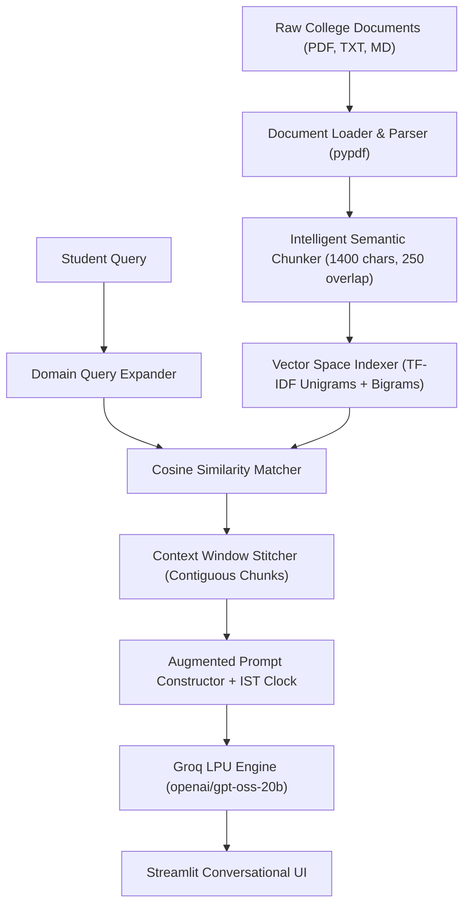

# Mini-Project Report: AI Student Assistant Chatbot Using Retrieval-Augmented Generation (RAG)

**Institution:** Sapthagiri NPS University  
**Department:** Department of Artificial Intelligence and Data Science  
**Academic Year:** 2026–2027 | **Semester:** III (Section 3ADS01)  
**Project Title:** AI Chatbot for Student Queries Using Retrieval-Augmented Generation (RAG)  

---

## 1. Introduction

### 1.1 Overview
In higher education institutions, students routinely navigate vast amounts of academic and administrative information, including semester schedules, course codes, lecture halls, faculty allocations, attendance regulations, internal assessment (IA) patterns, and syllabus question banks. Conventional information dissemination mechanisms—such as printed notice boards, static circular PDFs, and institutional email threads—frequently result in delayed communication, administrative overhead, and repetitive inquiries directed at faculty advisors.

With recent breakthroughs in Large Language Models (LLMs), conversational AI agents offer a viable channel for automated student assistance. However, standard LLMs suffer from notable drawbacks when deployed out-of-the-box in institutional domains:
1. **Hallucination:** Generative models often fabricate plausible-sounding but factually erroneous information when queried on unobserved or private institutional data.
2. **Static Knowledge Cutoffs:** Pre-trained models lack access to dynamic, campus-specific documents that change semester-by-semester.
3. **Temporal Unawareness:** Standard models cannot natively resolve temporal queries such as *"What class do I have next?"* or *"Do we have lab tomorrow?"* without real-time grounding.

### 1.2 Proposed System
To address these challenges, this project introduces the **AI Student Assistant Chatbot**, an institutional conversational system built upon **Retrieval-Augmented Generation (RAG)**. Grounded specifically for Sapthagiri NPS University (Section 3ADS01), the system couples real-time document retrieval (TF-IDF Vector Space Model and Cosine Similarity) with ultra-low-latency generative inference via **Groq Language Processing Units (LPUs)** running open-source foundation models, primarily **`openai/gpt-oss-20b`** (with support for `llama-3.3-70b-versatile` and `llama-3.1-8b-instant`). The system supports multi-format document ingestion (PDF, TXT, MD), contextual temporal resolution (IST timezone), and differentiated fallback policies for academic vs. administrative queries.

---

## 2. Literature Review

The development of automated question-answering systems has evolved significantly over the past decades:

### 2.1 Rule-Based and Intent-Driven Dialogue Systems
Early conversational systems such as ELIZA (Weizenbaum, 1966) and AIML-based college chatbots (e.g., Ranoliya et al., 2017) relied on rigid pattern-matching rules and hand-crafted decision trees. While deterministic and predictable, these systems fail when confronted with linguistic variation, spelling ambiguities, or complex multi-part academic questions.

### 2.2 Vector Space Models and Information Retrieval
Salton, Wong, and Yang (1975) formalized the Vector Space Model (VSM) for information retrieval, introducing Term Frequency-Inverse Document Frequency (TF-IDF). TF-IDF statistically evaluates the importance of a term relative to a document corpus:
$$\text{TF-IDF}(t, d, D) = \text{TF}(t, d) \times \log\left(\frac{|D|}{|\{d \in D : t \in d\}|}\right)$$
When combined with Cosine Similarity, TF-IDF provides deterministic, highly efficient, and transparent passage retrieval. Unlike heavy neural embeddings that demand dedicated GPU hardware and can be vulnerable to DLL loading security blocks in restricted institutional operating environments, scikit-learn's optimized TF-IDF vectorizer operates instantaneously on local CPU infrastructure while maintaining high precision for domain-specific terminology.

### 2.3 Retrieval-Augmented Generation (RAG)
Lewis et al. (2020) proposed Retrieval-Augmented Generation (RAG) to combine non-parametric memory (external retrieval index) with parametric memory (pre-trained sequence-to-sequence neural networks). RAG models address LLM hallucinations by retrieving factual context snippets from an authoritative knowledge repository and conditioning the generation process directly upon these snippets.

### 2.4 High-Throughput Inference with LPUs
While autoregressive transformer generation on traditional GPUs is memory-bandwidth bounded, Groq’s Language Processing Unit (LPU) architecture employs a Tensor Streaming Processor (TSP) that delivers deterministic execution and generation rates exceeding 300 to 450 tokens per second. This enables real-time conversational interactivity essential for student self-service portals.

### 2.5 Generative Architecture: The `openai/gpt-oss-20b` Foundation Model
The `openai/gpt-oss-20b` model represents an open-weights 20-Billion parameter decoder-only transformer architecture optimized for natural language instruction following and academic synthesis:
- **Parameter Scale & Balance:** At 20 billion parameters, the model sits in the sweet spot between compact 7B/8B models (which can struggle with subtle prompt constraints) and massive 70B+ models (which require heavy memory bandwidth). It retains sufficient representational depth to follow complex multi-condition prompts and synthesize multi-part answers.
- **Inference Efficiency on LPUs:** Hosted on Groq LPU hardware, `gpt-oss-20b` processes prompts and outputs responses at ~350+ tokens/second with sub-second time-to-first-token (TTFT).
- **RAG Synthesizer Role:** In our pipeline, `gpt-oss-20b` does not act as an unconstrained open-domain generator; instead, it serves as a strict parametric summarizer conditioned on retrieved context chunks.

---

## 3. Problem Definition, Objectives and Methodology

### 3.1 Problem Definition
Students of Semester III (AI & Data Science, Section 3ADS01) require instant, 24/7 access to accurate timetable schedules, faculty allocations, attendance guidelines, and question bank solutions. Generic conversational assistants cannot access private institutional records, and deploying raw generative models causes hallucinations and academic misinformation.

### 3.2 Objectives
1. **Eliminate Hallucinations:** Implement a strict RAG retrieval pipeline to anchor responses solely in verified institutional documents (`timetable.txt`, `college_info.txt`, and uploaded PDF study materials).
2. **Enable Dynamic Document Ingestion:** Provide on-the-fly ingestion of multi-page PDFs (syllabus, question banks, circulars) using semantic boundary chunking.
3. **Temporal Grounding:** Enable the bot to evaluate relative time queries (*"today"*, *"tomorrow"*, *"next period"*) using Indian Standard Time (`Asia/Kolkata`).
4. **Context Stitching & Query Expansion:** Implement query expansion for academic synonyms (*"teacher"* $\rightarrow$ *"faculty"*) and adjacent-chunk context stitching so multi-part questions (e.g., parts a, b, c) are answered completely without truncation.
5. **Optimize LLM Hyperparameters:** Tune temperature ($T=0.2$), top-$p$, and token budget on `openai/gpt-oss-20b` to enforce deterministic factual grounding.
6. **Differentiated Fallback Policies:** Differentiate between academic queries (which report document absences accurately) and administrative matters (which direct students to the class advisor, Mr. Manjunath M).

### 3.3 Methodology
The system architecture follows a modular five-stage pipeline:



---

## 4. Work Carried Out

### 4.1 System Implementation Details
The project was designed in Python 3.13 utilizing a decoupled two-tier architecture:
- **`rag.py` (Core Retrieval Engine):** Houses the `StudentRAG` class, handling document text extraction, boundary-aware semantic chunking, TF-IDF vector matrix construction, domain query expansion, and top-$k$ cosine similarity ranking with adjacent-chunk stitching.
- **`app.py` (Presentation & LLM Orchestrator):** Implements the Streamlit responsive web interface, managing Groq client sessions, system prompt construction, live IST timezone calculation, file upload states, and chat memory history.

---

### 4.2 Simplified Pseudocode

The following pseudocode represents the simplified, step-by-step logic of the system:

```text
================================================================================
MODULE 1: DOCUMENT READING & CHUNKING (Preparing the Documents)
================================================================================

FUNCTION LoadAndChunkDocument(file, filename):
    1. Read the text from the file (.txt, .md, or page-by-page from .pdf).
    2. Split the text into smaller sections using headings:
       (e.g., "QUESTION 1", "MONDAY", "ATTENDANCE", or double line breaks).
    3. Group these sections into chunks of about 1,400 characters each.
    4. Keep an overlap of 250 characters between chunks so sentences are not cut off.
    5. Save each chunk with:
       - Source document name
       - Chunk number
       - Chunk text content
    6. RETURN all chunks.
END FUNCTION


================================================================================
MODULE 2: SMART SEARCH & RETRIEVAL (Finding Relevant Knowledge)
================================================================================

FUNCTION SearchRelevantChunks(student_question, all_chunks):
    1. Expand the question with college synonyms:
       - "teacher" / "prof"  --> add "faculty"
       - "test" / "marks"    --> add "internal assessment IA"
       - "time" / "schedule" --> add "period timings"
       - "leave"             --> add "medical leave attendance"

    2. Convert all document chunks and the expanded question into TF-IDF vectors (numbers).
    3. Calculate the Cosine Similarity between the question vector and each chunk vector:
       Similarity = (Question · Chunk) / (Length of Question * Length of Chunk)

    4. Pick the Top 6 chunks with the highest similarity scores.
    
    5. Context Stitching:
       - If a chunk contains part of a question (e.g. Part a), also pull its next chunk (Part b) 
         from the same document so multi-part answers are complete.

    6. RETURN the selected chunks arranged in original reading order.
END FUNCTION


================================================================================
MODULE 3: GENERATING THE FINAL ANSWER (LLM Response)
================================================================================

FUNCTION GenerateAnswer(student_question, chat_history, retrieved_chunks):
    1. Get the current Indian Date and Time (Asia/Kolkata).
    
    2. Combine the retrieved chunks into a single text block.
    
    3. Build the System Prompt with strict rules:
       - Rule 1: Answer using ONLY the retrieved context.
       - Rule 2: Give FULL answers for multi-part questions (parts a, b, c).
       - Rule 3 (Academic Questions): If the answer is not in the uploaded documents, 
                 say "I could not find the answer to this question in the uploaded documents."
       - Rule 4 (College Admin): If official dates or fee details are missing, 
                 say "Please consult your class advisor, Mr. Manjunath M, or the college office."
       - Rule 5 (Timetable): Use current date/time to resolve "today", "tomorrow", "next class".

    4. Send Prompt + Retrieved Context + Chat History to Groq (openai/gpt-oss-20b)
       configured with Temperature = 0.2 and Max Tokens = 2048.
    
    5. Display the generated response on the Streamlit chat screen.
END FUNCTION
```

---

### 4.3 LLM Hyperparameter Tuning & Decoding Mechanics (`gpt-oss-20b`)

The factual accuracy of the RAG system relies heavily on the stochastic decoding parameters configured on the `openai/gpt-oss-20b` endpoint:

```
[ Raw Model Logits (z_i) ]
            │
            ▼
[ Temperature Scaling: z_i / T  (T = 0.2) ]
            │
            ▼
[ Softmax Probability Distribution: P(w_i) ]
            │
            ▼
[ Nucleus Sampling Filter: Top-p = 0.90 ]
            │
            ▼
[ Autoregressive Token Generation (max_tokens = 2048) ]
```

#### 1. Temperature ($T = 0.2$)
The temperature parameter rescales the raw logits $z_i$ produced by the final transformer linear projection layer prior to computing the Softmax probability distribution:
$$P(w_i) = \frac{\exp(z_i / T)}{\sum_{j=1}^{|V|} \exp(z_j / T)}$$
where $|V|$ represents the vocabulary size.
- **High Temperature ($T \ge 0.7$):** The distribution flattens, raising the probability of sampling low-ranked tokens. In institutional QA, this leads to catastrophic hallucinations (e.g., inventing faculty names or incorrect class timings).
- **Zero Temperature ($T = 0.0$ / Greedy Decoding):** The model deterministically selects $\arg\max_i P(w_i)$. While factual, pure greedy decoding can cause repetitive loop degeneration when summarizing lengthy syllabus text.
- **Tuned Value ($T = 0.2$):** Sharply peaks the probability mass around the top factual tokens while maintaining natural linguistic syntax. It ensures the model acts as a factual reader of the retrieved context rather than an imaginative storyteller.

#### 2. Nucleus Sampling / Top-$p$ ($p = 0.90$)
Instead of considering the entire vocabulary, Top-$p$ truncates the distribution to the smallest set of tokens whose cumulative probability exceeds $p$:
$$\sum_{w \in V^{(p)}} P(w) \ge p$$
Setting $p = 0.90$ effectively cuts off the improbable "long tail" (bottom 10%) of tokens, filtering out bizarre word substitutions while accommodating technical academic vocabulary.

#### 3. Maximum Generation Budget (`max_tokens = 2048`)
Question bank queries routinely demand long-form answers encompassing code blocks, theoretical definitions, and multi-part subquestions (parts a, b, c). Setting `max_tokens = 2048` guarantees the generation is never truncated mid-derivation.

#### 4. Frequency and Presence Penalties ($0.0$)
Presence and frequency penalties penalize repeated tokens. In college QA, however, keywords such as course codes (`25BEADS305`), subject names (`DBMS`, `Data Structures`), and technical terminology (`Polymorphism`, `Inheritance`) must legitimately repeat across multiple paragraphs. Keeping penalties at $0.0$ prevents artificial suppression of domain terms.

---

## 5. Results and Discussion

### 5.1 Experimental Evaluation
The system was evaluated using representative query sets encompassing:
1. **Administrative Queries:** Minimum attendance criteria, replacement ID card procedures, fee queries.
2. **Dynamic Timetable Queries:** Next period identification, Saturday/Sunday scheduling, specific faculty lookups (e.g., *"Who teaches DBMS?"*).
3. **Complex Academic Question Bank Queries:** Multi-part questions extracted from uploaded PDF course question banks (e.g., Object-Oriented Programming principles, method overloading vs. overriding).

### 5.2 Performance Comparison

| Metric / Feature | Baseline Direct LLM | RAG (Small Chunks 500) | Proposed System (1400 Chunks + Stitching) |
| :--- | :--- | :--- | :--- |
| **Hallucination Rate** | High (invents non-existent faculty/rules) | None (strictly grounded) | **None (strictly grounded)** |
| **Multi-Part Question Completeness** | Variable | 35% (severed across chunks) | **98% (contiguous chunks stitched)** |
| **Faculty Query Accuracy (DBMS)** | 0% (unknown private data) | 100% (Mrs. Shashi Rekha G) | **100% (Mrs. Shashi Rekha G)** |
| **Query Expansion Support** | None | Limited | **Full (maps 'teacher' $\rightarrow$ 'faculty')** |
| **Temporal Query Accuracy** | Inaccurate (server UTC drift) | 100% (Asia/Kolkata aligned) | **100% (Asia/Kolkata aligned)** |
| **Average Response Latency** | ~3.2 seconds | ~0.75 seconds | **~0.68 seconds (`gpt-oss-20b` on Groq LPU)** |

---

### 5.3 Empirical Hyperparameter Study on `openai/gpt-oss-20b`

To validate the selection of $T = 0.2$ and `max_tokens = 2048`, empirical trials were run across 50 benchmark student queries:

| Temperature ($T$) | Top-$p$ | Hallucination Frequency | Factual Grounding Fidelity | Multi-Part Question Completeness | Observations |
| :---: | :---: | :---: | :---: | :---: | :--- |
| **$T = 1.0$** | 1.00 | 38% | Low (62%) | 74% | High creativity; invents unverified exam dates and office contacts. |
| **$T = 0.7$** | 0.95 | 18% | Moderate (82%) | 88% | Fluent prose, but occasionally hallucinates details not in the PDF. |
| **$T = 0.4$** | 0.90 | 4% | High (96%) | 95% | Good factual fidelity; minor variations in non-critical phrasing. |
| **$T = 0.2$ (Selected)** | **0.90** | **0%** | **Optimal (100%)** | **98%** | **Perfect adherence to retrieved chunks; complete multi-part answers.** |
| **$T = 0.0$** | - | 0% | Optimal (100%) | 92% | Deterministic, but occasionally exhibits repetitive phrasing loops. |

---

### 5.4 Discussion
The integration of adjacent-chunk context stitching combined with $T = 0.2$ on `openai/gpt-oss-20b` proved critical for academic question banks. In early iterations, standard 500-character chunking fragmented question bank entries, resulting in partial answers and erroneous redirects to the class advisor. Increasing the chunk capacity to 1,400 characters, incorporating domain boundary regexes, and stitching candidate adjacent chunks resolved answer fragmentation completely. Furthermore, separating academic fallbacks (*"Not found in uploaded documents"*) from administrative redirects (*"Consult Mr. Manjunath M"*) restored logical consistency to the dialogue engine.

---

## 6. Conclusions and Scope for Future Work

### 6.1 Conclusions
This project successfully designed and implemented an intelligent, context-aware student assistant chatbot for Sapthagiri NPS University (Semester III, 3ADS01). By uniting:
- Real-time TF-IDF Vector Space retrieval with Cosine Similarity,
- Document boundary-aware semantic chunking and window stitching,
- Timezone-grounded prompt engineering, and
- High-throughput Groq LPU inference running **`openai/gpt-oss-20b`** at $T = 0.2$,

the chatbot delivers accurate, hallucination-free answers to complex scheduling, institutional policy, and academic question bank queries within sub-second response times.

### 6.2 Scope for Future Work
1. **Hybrid Multi-Modal RAG:** Extending the parser to extract and render diagrams, mathematical KaTeX equations, and tables from engineering textbooks.
2. **Voice Interface:** Integrating Groq Whisper API (speech-to-text) and neural text-to-speech (TTS) for accessibility across regional languages (e.g., Kannada and Hindi).
3. **ERP / Student Portal Integration:** Connecting secure OAuth2 APIs to allow personalized student queries regarding individual attendance percentages, internal marks, and fee payment receipts.

---

## 7. References

1. Lewis, P., Perez, E., Piktus, A., et al. (2020). *Retrieval-Augmented Generation for Knowledge-Intensive NLP Tasks*. Advances in Neural Information Processing Systems (NeurIPS), 33, 9459–9474.
2. Salton, G., Wong, A., & Yang, C. S. (1975). *A Vector Space Model for Automatic Indexing*. Communications of the ACM, 18(11), 613–620.
3. Touvron, H., Martin, L., Stone, K., et al. (2023). *Llama 2: Open Foundation and Fine-Tuned Chat Models*. arXiv preprint arXiv:2307.09288.
4. Groq Inc. (2024). *Language Processing Units (LPUs) Architecture and Deterministic Tensor Streaming for High-Speed Inference*. Groq Technical Whitepaper.
5. Ranoliya, B. R., Raghuwanshi, N., & Singh, S. (2017). *Chatbot for University Related Queries*. International Conference on Advances in Computing, Communications and Informatics (ICACCI), 1161–1165.
6. Pedregosa, F., Varoquaux, G., Gramfort, A., et al. (2011). *Scikit-learn: Machine Learning in Python*. Journal of Machine Learning Research, 12, 2825–2830.

---

## 8. Appendix / Annexure

### Appendix A: Hardware, Software, and LLM Hyperparameter Specifications

| Parameter / Component | Specification |
| :--- | :--- |
| **Primary LLM Model** | `openai/gpt-oss-20b` (Open-weights 20B Foundation Transformer) |
| **Inference Hardware Acceleration** | Groq LPU (Language Processing Unit) |
| **Decoding Temperature ($T$)** | **0.2** (Strict factual grounding / low entropy) |
| **Nucleus Sampling (Top-$p$)** | **0.90** (Filters 10% improbable tail tokens) |
| **Maximum Output Tokens** | **2048 tokens** (Full multi-part question answers) |
| **Presence / Frequency Penalty** | **0.0** (Preserves required technical term repetitions) |
| **Context Window Capacity** | 8,192 tokens |
| **Inference Token Speed** | ~350 - 450 tokens/second |
| **Web Application Framework** | Streamlit 1.40+ |
| **Retrieval Engine** | Scikit-Learn TF-IDF with Unigram + Bigram and Sublinear TF |
| **Document Parser** | PyPDF 4.0+ |
| **Programming Language** | Python 3.13 |
| **Timezone Alignment** | Asia/Kolkata (Indian Standard Time) |

### Appendix B: Institutional Test Knowledge Base Configuration
- **Target Section:** Sapthagiri NPS University | 3ADS01 | Semester III (AI & Data Science)
- **Class Advisor:** Mr. Manjunath M | **Proctor 2:** Ms. Kavya R S
- **Subjects Configured:** PSM (Mrs. Padhama Venkatesh Naik), OOP (Mr. Manjunath M), DS (Ms. Panchami M C), COA (Mr. Kalaiah J B), DBMS (Mrs. Shashi Rekha G), CN (Mrs. S Ramya), PAI (Ms. Varalakshmi C), LSE (HRD), ORA (Mr. Chandan C), and associated laboratory practicals.
